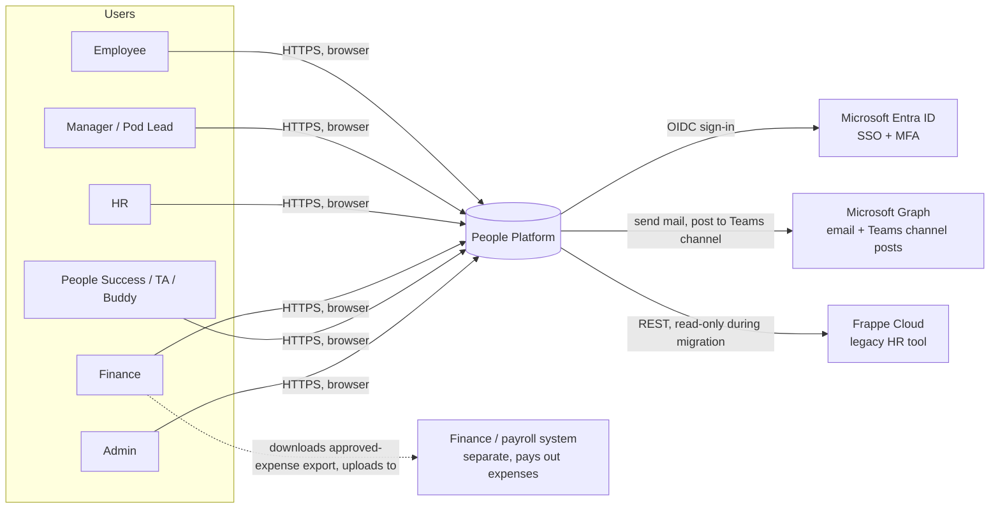
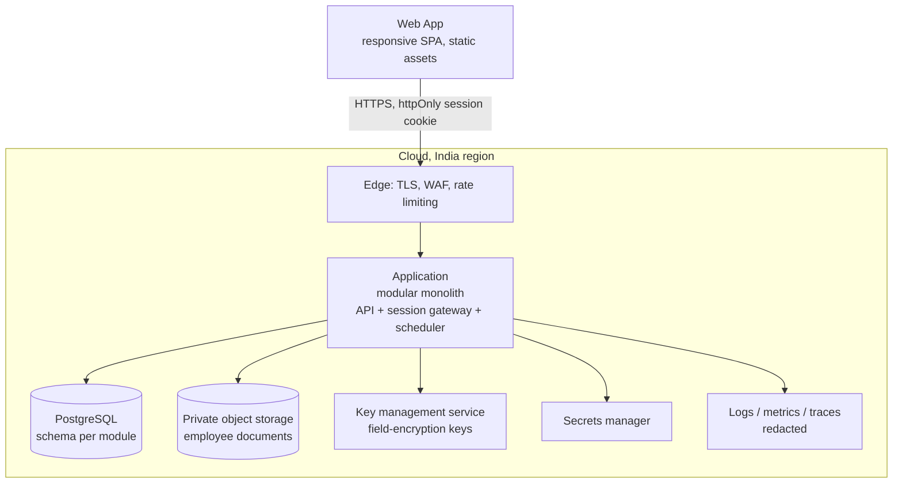

# Solution Architecture

> **Out of date, parked until Stage 6.** Written before the current scope. Where it differs from the [PRD](../../stage-3-product-definition/02-prd.md) (releases, leave rules and approvals, roles, audit access, data move), the PRD is correct.

> This document describes the system's structure, boundaries and key design decisions **independently of technology**. The language, framework and cloud provider are not yet chosen. Section 13 gives the criteria for choosing them. Wherever a decision depends on the stack, it is written as a capability ("managed PostgreSQL with point-in-time restore"), not as a product.

---

## 1. Scope

- **In scope (v1):**
  - **Platform:** Identity & Access, Audit Log, Notifications, Files.
  - **Part A, HR foundation:** People, Leave & Holidays, Onboarding/Offboarding (Lifecycle), Frappe Importer.
  - **Part B, core people modules:** Teams (pods), Assignments (clients, projects, allocations), Expenses (claims, Finance approval, export), Feedback & Reviews (peer feedback, 360 review cycles), PIP, Policies & Announcements (broadcast to portal, email and a Teams channel), Letters & Self-Service Documents.
- **v1.5:** Reporting.
- **Out of scope:** payroll calculation, accounting (GL, tax, invoicing), expense payout tracking, full resourcing (bench, roll-off, staffing search, utilisation), any link from reviews to pay, Teams/Slack/mobile apps, and an AI assistant.
- **Scale:** fewer than 300 employees, all in India, sized for up to 1,000. This is a small system with high sensitivity, so **correctness and security matter far more than throughput**.

## 2. Architecture Drivers

These are ranked. When two drivers conflict, the higher one wins.

| # | Driver | What it means for the design |
|---|---|---|
| 1 | **Security and privacy** | Deny by default. Every access check happens on the server, in one place. Sensitive fields, and confidential performance data (PIPs, reviews, feedback), are encrypted with separately managed keys. A denied request returns "not found", so it doesn't reveal that the record exists. No sensitive data in logs. DPDP-ready. |
| 2 | **Auditability** | Every write, every sensitive read and every access denial produces a tamper-evident audit entry, written atomically with the change. |
| 3 | **Correctness of HR rules** | Leave balances are derived from an append-only ledger. Scheduled jobs are idempotent. Concurrent edits are detected, not lost. |
| 4 | **Maintainability** | Modular monolith with enforced boundaries. Each module owns its data. Boundaries are checked by automated tests. |
| 5 | **Simplicity of operations** | One deployable, one database, managed cloud services. No message broker or microservices until there is a real trigger (section 12). |
| 6 | **Usability and accessibility** | Workflow-first API (task-shaped endpoints, not table-shaped CRUD). WCAG 2.2 AA front end. |
| 7 | **Performance** | p95 page load under 2s and search under 1s at 1,000 employees. Easily met at this scale without caching layers. |

## 3. System Context



| External system | Direction | Purpose | Notes |
|---|---|---|---|
| Microsoft Entra ID | Platform → Entra | Single sign-on (OpenID Connect), MFA enforced by Entra policy | Accept only the Incubyte tenant. Map users by Entra object ID, not by email. |
| Microsoft Graph | Platform → Graph | Sending notification emails; posting policy and announcement broadcasts to Microsoft Teams channels | Email: a dedicated sender mailbox with an application permission scoped to that mailbox only. Teams: **posts as the publisher** using the publisher's delegated `ChannelMessage.Send` permission (decided, see section 6.9). Microsoft doesn't allow app-only channel posting for normal messages. |
| Frappe Cloud | Platform → Frappe | One-time, re-runnable data migration | Read-only API key, stored in the secrets manager, revoked after cutover. |

| Finance / payroll system | Platform → file → Finance | Approved expense claims, as an export file that Finance downloads and loads into their system | **No direct integration in v1.** A file export (format to confirm, CSV assumed) keeps the boundary simple and auditable. A direct API push can come later behind the same export use case. |

Payroll calculation and accounting are **not integrated** and stay in their own systems.

## 4. Containers (Deployable Pieces)



| Container | Responsibility | Key properties |
|---|---|---|
| **Web App (SPA)** | All user interfaces | Holds no tokens. Uses a same-site, httpOnly, secure session cookie issued by the application (the "backend-for-frontend" pattern). Built to WCAG 2.2 AA. Strict Content Security Policy. |
| **Application** | Every module, the API, the OIDC session gateway and scheduled jobs | One deployable, stateless (sessions kept in the database or a managed session store). Runs as at least 2 instances for availability, with one active scheduler elected by a database lock. |
| **PostgreSQL** | All persistent data | Managed service with encryption at rest, point-in-time restore and private networking only. One schema per module, each with its own database role. |
| **Object storage** | Uploaded documents (ID proofs, certificates) and expense receipts | Private bucket. Objects are only reachable through the application, using short-lived signed links issued after an access check. Encrypted. |
| **Key management** | Data keys for field-level encryption of sensitive values and confidential performance content (separate key per data class) | Keys are rotatable. The application can encrypt and decrypt but never export the master key. |
| **Secrets manager** | Database credentials, Entra client secret/certificate, Frappe API key, Graph credentials | No secrets in code, images or environment files. |
| **Observability** | Structured logs, metrics, traces, alerts | Sensitive fields and personal data are redacted before logging, enforced by a logging filter plus tests. |

Why a backend-for-frontend instead of tokens in the browser: it keeps access tokens out of JavaScript, makes the 30-minute idle timeout and the sign-out-on-exit rule enforceable on the server, and gives us a single place to revoke a session.

## 5. Module View (Inside the Monolith)

### 5.1 Modules and ownership

| Module | Owns (data + behaviour) | Public API (others may call) | Publishes events |
|---|---|---|---|
| `identity` | User accounts linked to Entra object IDs, role assignments, sessions, the authorisation policy | `currentPrincipal()`, `can(principal, action, resource)`, `assignRole()` | `RoleAssigned`, `RoleRevoked`, `SignInSucceeded/Failed` |
| `audit` | Append-only audit entries | `record(entry)` (write-only), `search(query)` (Admin) | — |
| `people` *(core)* | Employee, org structure, reporting lines, departments, designations, locations, employment history, emergency contacts, sensitive fields (encrypted) | `getEmployee(id)`, `reportingLine(managerId)`, `locationOf(employeeId, date)`, `isActive(id)`, directory search | `EmployeeJoined`, `EmployeeUpdated`, `JoiningDateChanged`, `ManagerChanged`, `LocationChanged`, `EmployeeExitInitiated`, `EmployeeExited` |
| `leave` | Leave types and policies, holiday calendars, optional/floating holiday choices, balance ledger, leave requests, approval workflow | `balances(employeeId)`, `leaveOn(employeeId, dateRange)`, `isWorkingDay(employeeId, date)` | `LeaveRequested`, `LeaveApproved`, `LeaveRejected`, `LeaveCancelled`, `LeaveAwaitingHrApproval` |
| `lifecycle` | Checklist templates, onboarding/offboarding checklists, tasks, buddy assignment, asset handovers | `tasksFor(principal)`, `openMandatoryTasks(employeeId)` | `TaskAssigned`, `TaskOverdue`, `ChecklistCompleted` |
| `teams` | Pods, dated pod membership, pod leads | `podOf(employeeId, date)`, `membersOf(podId)`, `podsLedBy(employeeId)` | `PodMembershipChanged`, `PodLeadChanged` |
| `assignments` | Client and project reference records (no rates or billing), dated assignments with allocation % | `assignmentsOf(employeeId, dateRange)`, `allocationOn(employeeId, date)` | `AssignmentChanged`, `AssignmentEnded` |
| `expenses` | Expense categories and limits, claims, claim items, receipt references, Finance decisions, export batches | `claimsFor(principal)` (claimant / Finance only) | `ExpenseClaimSubmitted`, `ExpenseClaimApproved`, `ExpenseClaimRejected`, `ExpensesExported` |
| `feedback` | Peer feedback, share-with-manager grants, moderation; review cycles, question sets, nominations, self/peer/manager reviews, acknowledgements | `reviewTasksFor(principal)` | `FeedbackGiven`, `ReviewCycleLaunched`, `ReviewTaskAssigned`, `ReviewFinalised` |
| `pip` | Performance improvement plans, goals and success criteria, check-ins, outcomes, acknowledgements (encrypted, confidential class) | none beyond its own use cases. **No other module may query PIPs.** | `PipActivated`, `PipCheckInDue`, `PipClosed` (consumed by notifications only) |
| `policies` | Policy documents and versions, applicability (location), mandatory flag, acknowledgements; announcements (audience, pin, expiry); **broadcast records** | `currentPoliciesFor(employeeId)` | `PolicyPublished`, `PolicyVersionPublished`, `AnnouncementPublished` |
| `letters` | Letter templates per type, letter requests, approvals, generated letters with reference numbers | (own use cases only) | `LetterRequested`, `LetterIssued` |
| `notifications` | Notification messages, in-app inbox, channel adapters (in-app, email, **Teams channel**), delivery attempts and status per channel | `notify(recipient, template, params)`, `broadcast(audience, channels, message) → deliveryIds` | `BroadcastDelivered`, `BroadcastDeliveryFailed` |
| `files` | Stored document metadata and object keys | `store()`, `issueDownloadLink(fileId, principal)` | — |
| `integration` | Frappe import runs, ID mapping, staging data, reconciliation reports | (Admin-only use cases) | `ImportRunCompleted` |
| `reporting` *(v1.5)* | Read models: headcount, attrition, leave usage, onboarding progress, expense and review-completion summaries, allocation summaries. **Never PIPs, never feedback or review text.** | report queries | — |

### 5.2 Dependency rules

```
                 ┌──────────┐
                 │ identity │◄───────────── every module asks identity "can this principal do X?"
                 └────┬─────┘               (identity keeps manager + pod-lead scopes current
                      │ uses                 from people and teams EVENTS, never by calling them)
                 ┌────▼─────┐
   ┌────────────►│  people  │◄─────────────────────────────────────┐
   │             └────┬─────┘                                      │
   │                  │ events                                     │
┌──┴────┐ ┌─────────┐ ┌▼────────┐ ┌───────────┐ ┌────────┐ ┌──────┐ ┌───┴───────┐
│ leave │ │lifecycle│ │  teams  │ │assignments│ │expenses│ │feedbk│ │integration│
└──┬────┘ └────┬────┘ └───┬─────┘ └─────┬─────┘ └───┬────┘ └──┬───┘ └─────┬─────┘
   │           │          │             │           │         │  ┌─────┐  │
   │           │          │             │           │         │  │ pip │  │
   │           │          │             │           │         │  └──┬──┘  │
   ▼ events    ▼          ▼             ▼           ▼         ▼     ▼     ▼
┌──────────────────────────────────────────────────────────────────────────────┐
│ notifications · files · audit (leaf modules)                                 │
└──────────────────────────────────────────────────────────────────────────────┘
          reporting (v1.5): read-only, consumes events / public queries (never pip)
```

The Part B modules (`teams`, `assignments`, `expenses`, `feedback`, `pip`) depend **only on `people`, `identity` and the leaf modules**. They don't depend on each other. This keeps them independently buildable, and means Part B can ship in any order once Part A's backbone exists.

1. A module may call another module **only through its public API**. Its internal classes, repositories and tables are private.
2. **No module reads another module's schema.** Database roles enforce this: each module's role can access only its own schema.
3. Dependencies point **towards** `people` and `identity`, never out of them. `people` must not depend on `leave` or `lifecycle`; it learns nothing about them.
4. Reactions that cross a module boundary go through **events** (for example, `EmployeeJoined` → lifecycle creates the onboarding checklist). Synchronous calls are used only for queries the caller needs in order to answer (for example, `isWorkingDay`).
5. `audit`, `notifications` and `files` are **leaf modules**: they depend on nothing except `identity` for access checks.
6. **`pip` is a sealed module.** It exposes no query API to other modules, and no module (including `reporting`) may read it. The only things leaving it are ID-only events for notifications and audit entries.
7. All of the above is checked in CI with **architecture tests** (boundary tests in the spirit of ArchUnit), so a violation fails the build.

### 5.3 Events

- Events are **in-process** (no broker) and delivered through a **transactional outbox**. The publishing module writes the event to its own `outbox` table in the same transaction as the state change. A dispatcher delivers it to subscribers after commit, and retries on failure.
- Subscribers are **idempotent**. Each records processed event IDs, so a redelivery has no effect.
- Why use an outbox even inside one process: email delivery and checklist creation must not be lost if the process crashes between commit and handling, and must not happen at all if the transaction rolls back.
- Event payloads contain **IDs and non-sensitive facts only**. They never carry feedback text, review content, PIP details, receipt contents or amounts. A subscriber needing more data calls the owner's public API, which applies access checks.

| Event | Producer | Consumers |
|---|---|---|
| `EmployeeJoined` | people | lifecycle (start onboarding), notifications |
| `JoiningDateChanged` | people | lifecycle (shift due dates) |
| `ManagerChanged` | people | leave (re-route pending approvals), identity (scope cache), feedback (move in-progress manager reviews), pip (switch manager access immediately) |
| `LocationChanged` | people | leave (holiday calendar from effective date) |
| `EmployeeExitInitiated` | people | lifecycle (start offboarding), leave (cancel leave after last working day) |
| `EmployeeExited` | people | identity (block sign-in, end sessions), lifecycle, teams (end membership), assignments (end assignments), feedback (withdraw from open cycles), pip (close as "employee exited") |
| `PodMembershipChanged` / `PodLeadChanged` | teams | identity (pod-lead scope) |
| `AssignmentChanged` / `AssignmentEnded` | assignments | notifications, reporting |
| `ExpenseClaimSubmitted` / `Approved` / `Rejected` | expenses | notifications |
| `ExpensesExported` | expenses | audit (via the use case), reporting |
| `FeedbackGiven` | feedback | notifications (recipient: "you have new feedback", no text) |
| `ReviewCycleLaunched` / `ReviewTaskAssigned` / `ReviewFinalised` | feedback | notifications, scheduler (deadline reminders) |
| `PipActivated` / `PipCheckInDue` / `PipClosed` | pip | notifications only ("you have an item to review", no details) |
| `LeaveRequested` / `LeaveAwaitingHrApproval` | leave | notifications |
| `LeaveApproved` / `LeaveRejected` / `LeaveCancelled` | leave | notifications, reporting |
| `TaskAssigned` / `TaskOverdue` | lifecycle | notifications |

## 6. Cross-Cutting Designs

### 6.1 Authentication
- OpenID Connect authorisation-code flow with PKCE against Entra ID, handled **by the application** (backend-for-frontend), not the SPA.
- Only tokens from the Incubyte tenant are accepted. Users are matched on the Entra **object ID**, which is linked to an employee record once (at import or creation), never re-matched by email.
- Sign-in is refused if there is no linked employee, or if the employee is exited. Both cases are audited.
- Sessions are server-side, with a 30-minute idle timeout, an absolute maximum lifetime, rotation on sign-in, and immediate revocation on sign-out and on `EmployeeExited`.
- MFA and conditional access are enforced in Entra, not reimplemented in the platform.

### 6.2 Authorisation (roles × scopes × fields)
- **One policy point.** Every use case calls `identity.can(principal, action, resource)` before acting, and every query is filtered by the principal's scope. Hiding a button in the UI is never the only check.
- **Roles:** Employee, Manager (derived from having reports), Pod Lead (derived from `teams`), HR, Finance, People Success, TA, Buddy (derived from an assignment), Admin. A person can hold several.
- **Scopes:**
  - `self`
  - `reportingLine` (direct and indirect, computed from people's org tree), plus `directReports` (direct only, used for reviews and PIPs)
  - `pod` (current members of pods the principal leads)
  - `assigned` (checklists, tasks, review tasks)
  - `participant` (a specific piece of feedback or review: its giver, recipient, or an item shared with the manager)
  - `all`
- **Field-level rule for sensitive data:** only `self` and `HR` may reveal, and every reveal is audited. Managers and Admins never receive these fields, even masked. They are left out of the response, not just blanked.
- **Confidential performance rule:** PIP, review and feedback content is governed by **record-level participant rules**, not role alone. A PIP is accessible only to the employee, their current direct manager and HR. Peer feedback only to the giver, the recipient, HR, and the manager if shared. Review content follows the PRD's visibility table. Any other principal gets **"not found"**, and the attempt is audited as a denied access.
- **Finance boundary:** Finance sees expense claims, receipts and directory-level details of claimants only. No HR sensitive fields, no performance data. Nobody can approve their own claim, even if they hold the Finance role.
- **Pod lead boundary:** pod leads see pod members' work profile, assignments and leave dates (without type or reason). They get no reviews, PIPs, feedback or sensitive fields, and no approval rights.
- **Deny by default.** Anything not explicitly allowed is refused, and the refusal is audited.
- **Separation of duties:** Admin manages roles and settings but cannot see sensitive data without also holding HR. Assigning the HR role is audited and should require a second Admin (to be confirmed).
- The policy is written as data plus code in `identity`, and is covered by a **permission matrix test suite**: every role × action × scope combination is tested.

### 6.3 Sensitive-data protection
- Sensitive fields (salary, PAN, Aadhaar, bank account, IFSC) live in a separate `people.employee_sensitive` table, apart from general profile data.
- **Application-level envelope encryption:** each value is encrypted with a data key that is itself protected by the KMS master key. A database dump or backup alone exposes nothing.
- Reads return **masked values by default** (last 4 digits). Revealing a full value is an explicit use case (`revealSensitiveField`) that is audited.
- Values that need lookup, such as checking a PAN for duplicates, use a keyed hash (blind index), never the plain text.
- Sensitive values are excluded from logs, error messages, events, notifications, exports and analytics. This is enforced by type (a `Sensitive<T>` wrapper that refuses to be converted to a string) plus a redacting log filter.
- Non-production environments never hold real personal data. They use synthetic seed data.
- **Confidential performance content** (PIP goals, check-ins, outcomes; review answers; feedback text) uses the same envelope encryption with a **separate data key class**, so a key compromise or misconfiguration on one class doesn't expose the other. This content is wrapped in the same `Sensitive<T>` type and is never logged, notified, exported or indexed for search.

### 6.4 Audit log
- `audit.entries` is **append-only**. The application's database role has INSERT and SELECT only. No UPDATE, DELETE or TRUNCATE is granted to anyone except a break-glass role whose use is itself alerted on.
- Audit entries for writes are written **in the same transaction** as the change, so there can be no change without its audit entry, and no audit entry for a change that was rolled back.
- Each entry records: actor, on-behalf-of (for example, HR approving for a manager), action, subject employee, resource, changed fields with old and new values (sensitive values stored as "changed", never in plain text), outcome, time, request ID and source (UI, import or job).
- **Tamper evidence:** each entry stores a hash of the previous entry (a hash chain). A daily job verifies the chain and alerts on any break.
- Sensitive reads, access denials, sign-ins, imports and audit-log searches are all audited, as are every view of a PIP, review or feedback item, every expense decision and every expense export.
- **Restricted audit partition:** audit entries about PIPs (and, by default, reviews) carry a `restricted` flag. Searching them requires the HR role. Admin alone sees only that a restricted entry exists, not its subject. Otherwise the audit log itself could leak that a PIP exists.
- Retention follows legal requirements (placeholder: 7 years). Old entries move to cold, immutable storage rather than being deleted early.

### 6.5 Concurrency and consistency
- Each aggregate (employee, leave request, checklist) carries a **version number**. A save with an older version is rejected with "this record was changed by someone else", so no update is silently lost.
- Leave decisions use a guarded state transition, so only the first decision on a request counts.
- Each request runs inside one transaction within one module. Consistency between modules is **eventual, via the outbox**, typically within seconds.

### 6.6 Scheduled jobs
- Jobs: monthly or periodic accrual, year-end carry-forward and lapse, overdue-task reminders, review-cycle deadline reminders, PIP check-in and acknowledgement reminders, notification retries, audit chain verification, and retention enforcement.
- They run in the application's scheduler, and a **database advisory lock** ensures only one instance runs each job.
- Every job is **idempotent and resumable**. Each unit of work has a natural key (for example `accrual:{leaveType}:{employee}:{period}`) protected by a unique constraint, so re-running a job after a crash never double-credits.

### 6.7 Files
- Uploads go through the application: type is checked by content (not just extension), size is limited, and malware scanning is recommended (to be decided).
- Only metadata and the owner module's reference live in the database. The bytes live in private object storage.
- A download is a short-lived signed link, issued only after `files` asks the owning module (for example, `people` or `lifecycle`) whether the principal may see the file.

### 6.8 Notifications
- `notify()` stores the message in the in-app inbox first, then queues email delivery through Microsoft Graph with retry and backoff. If email fails, the in-app notification still exists.
- Templates are plain and contain **no sensitive data**. Emails link back to the app instead of carrying details.

### 6.9 Broadcasts (policies and announcements to portal, email and Teams)
- Publishing a policy, a policy version or an announcement is **one transaction** in `policies`. It saves the item, creates a `BroadcastRecord` with one `ChannelDelivery` per target (portal, email, each Teams channel), and writes `AnnouncementPublished` / `PolicyPublished` to the outbox.
- `notifications` delivers each channel **independently**. The portal entry and in-app notification are immediate. Email goes to every employee in the audience, resolved from `people` and `teams` at publish time, sent in batches and throttled to Microsoft 365 limits. The Teams post goes to the configured channel(s).
- Each `ChannelDelivery` records status (`pending → sent | failed`), attempts, timestamp, and for Teams the channel name and the posted message's ID/link. A failure in one channel never blocks the others. Failed deliveries retry with backoff, and the publisher can **resend** a failed channel, which is audited.
- The **broadcast record is the permanent "when and where" history** shown on each item in the portal. It is append-only, like audit.
- **Teams channel posting identity (decided, ADR 021): post as the publisher.**
  - The first time a publisher publishes, the platform asks them to grant the delegated `ChannelMessage.Send` permission (incremental consent through the same Entra sign-in). An Entra admin can pre-approve this permission for the Announcer group so publishers aren't prompted.
  - The publisher's refresh token is stored **encrypted** (KMS), is scoped to that one permission, and is used only for broadcast posts they started. Their consent and token are revoked on `EmployeeExited`, on losing the Announcer permission, and on sign-out-everywhere.
  - Before publishing, the platform checks that the publisher is a member of each chosen channel. If not, publishing to Teams is blocked with a clear message.
  - If the token is missing or expired when delivery runs, the Teams `ChannelDelivery` is marked `failed: permission needed`. Portal and email are unaffected. The publisher is asked to re-grant permission and resend.
  - A **resend** posts under the identity of the person resending (who must hold Announcer permission and consent). The broadcast record keeps both the original publisher and the resender.
  - Risk: posting depends on individual user tokens. Mitigation: monitor Teams delivery failures, and keep a documented fallback (a bot or Workflows webhook posting as "Incubyte People") that can be switched on through configuration if delegated posting becomes unreliable.
- Teams messages are a rich card: title, short summary, published-by, and a "View in portal" link. Policy text and attachments stay in the portal, behind sign-in.
- Configuration: Admin maps channels (company-wide, and optionally per location or pod) in settings. Company-wide items always go to the general channel. For targeted items, the publisher chooses a mapped channel or skips Teams.

### 6.10 API style
- Task-shaped endpoints that mirror workflows (`POST /leave-requests`, `POST /leave-requests/{id}/approve`, `POST /employees/{id}/exit`), not generic table CRUD. This is the direct fix for Frappe's "form per table" UX.
- Responses are tailored to the screen and already filtered by scope and field rules on the server.
- Errors use a consistent problem format, with field-level validation messages the UI can show next to the field.
- An OpenAPI contract is the source of truth for the SPA client.

## 7. Domain Design Highlights

### 7.1 People
- `Employee` (stable ID, Entra object ID link, status: `pre-joining → active → exit-initiated → exited`).
- `EmploymentRecord` holds effective-dated rows for designation, department, location, manager and employment type. "What was X on date D" is a first-class query, used by holidays, approvals and reporting.
- The org tree is computed from current manager links. Creating a cycle is rejected at write time.

### 7.2 Leave & Holidays
- **Ledger-based balances.** A balance is never stored as one mutable number. It is the sum of immutable `LeaveLedgerEntry` rows: `ACCRUAL`, `DEBIT` (approved leave), `REVERSAL` (cancellation), `ADJUSTMENT` (HR, with a reason), `CARRY_FORWARD`, `LAPSE`, `OPENING_BALANCE` (migration). This gives the full balance history the PRD asks for, makes migration reconcilable, and makes jobs safe to re-run.
- **Policy as configuration** per leave type: entitlement, accrual schedule, carry-forward cap, half-day allowed, negative balance allowed, needs HR approval, eligibility window (for example, birthday leave). Accrual rules are an open PRD question, so the policy model is kept extensible (a strategy per accrual type).
- **Working-day calculator** = weekends + fixed holidays for the employee's location on that date + the employee's chosen optional holidays.
- **Approval state machine:**

```
          ┌─────────────── cancel ───────────────┐
          │                                      ▼
Submitted ─► PendingManager ─approve─► [needs HR?] ─yes─► PendingHR ─approve─► Approved
                  │                       │no                │                   │
                reject                    └──────────────────┼──────────────► Approved
                  ▼                                        reject                │ cancel (before start)
               Rejected                                      ▼                   ▼
                                                          Rejected           Cancelled (+REVERSAL)
```

- On `ManagerChanged`, pending manager approvals are re-routed to the new manager. HR can act on behalf of any approver, and this is audited as on-behalf-of.

### 7.3 Lifecycle (Onboarding/Offboarding)
- A `ChecklistTemplate` contains `TaskTemplate`s (owner role or specific person, offset in days relative to joining date or last working day, mandatory yes/no).
- A `Checklist` is created from a template when `EmployeeJoined` or `EmployeeExitInitiated` arrives. Due dates are recomputed on `JoiningDateChanged`.
- `AssetHandover` records are created at onboarding and automatically become return tasks at offboarding.
- An exit can't be completed while mandatory tasks are open. Removing Microsoft 365 access is a **tracked task** in v1, not automated (to be confirmed).

### 7.4 Teams (Pods) and Assignments
- `Pod` (name, lead) with **effective-dated** `PodMembership` rows. Each person is in at most one pod at a time (PRD assumption H12), enforced by a constraint on overlapping memberships.
- `Client` and `Project` are reference records only (name, status, dates). No rates, billing or margins.
- `Assignment` (employee, project, start, end, allocation %). Total allocation per employee per day must not exceed 100%, which is validated on save. The check runs inside the `assignments` module with a per-employee lock to avoid race conditions.
- Pod-lead access is **derived**: `teams` publishes `PodLeadChanged` and `PodMembershipChanged`, and `identity` maintains the `pod` scope from them. Pod leads therefore never need a role assigned by hand.
- Deliberately **not** built: bench views, roll-off forecasts and staffing search. The dated assignment model makes them possible later as read models, without changing this module.

### 7.5 Expenses
- `ExpenseClaim` → `ExpenseItem`s (date, category, amount in INR, description, receipt file reference).
- Category policy: per-item limit. An item over the limit can still be submitted, but needs a justification and is flagged for Finance (PRD assumption).
- **Duplicate-receipt detection:** a content hash of each receipt file, plus a (date, amount, category) match across the claimant's claims, flags likely duplicates to Finance. Flagged items aren't blocked.
- **State machine:**

```
Draft ─submit─► Submitted ─approve─► Approved ─export─► Exported (read-only)
  ▲                 │
  └── edit ◄── Returned (Finance asks for changes)
                    │
                  reject ─► Rejected
```

- Approver is **Finance only** (PRD assumption H9). The approval step is a pluggable policy, so adding a manager step later means changing configuration plus one state, not rewriting the module.
- **Export batches:** Finance selects approved, unexported claims and generates a batch file (CSV assumed). Each claim can belong to **exactly one batch**, enforced by a unique constraint, so a claim can't be paid twice. Re-downloading a batch gives the identical file. Every generation and download is audited.
- No payout tracking. `Exported` is the final state in this platform.

### 7.6 Feedback & Reviews
- **Peer feedback:** an immutable `FeedbackItem` (giver, recipient, text, created). The recipient can grant a `ShareWithManager` on a specific item. HR can **hide** a reported item, which is soft-hidden and audited, never deleted.
- **Review cycles (360):** `ReviewCycle` (name, participants, question set, deadlines per phase) → per participant: `SelfReview`, `PeerNomination`s (2–5 peers, manager can adjust), `PeerReview`s, `ManagerReview` → finalised → `Acknowledgement`.
- **Cycle state machine:** `Draft → Launched → SelfAndPeerPhase → ManagerPhase → Finalising → Closed`. Deadlines drive reminders via the scheduler. Phases can be extended by HR (audited).
- **Visibility is computed per artefact:** the employee sees their own self-review and the finalised manager review. Each peer sees only the review they wrote. The direct manager sees all reviews for their direct reports. HR sees all. Employees don't see individual peer reviews (PRD assumption).
- Questions are free text in v1. The question model leaves room for rating scales later.
- A manager change mid-cycle moves the open manager review to the new manager, and the old manager loses access (on `ManagerChanged`).

### 7.7 PIP
- `Pip` (employee, manager, HR owner, start, end, status) → `PipGoal`s (each with success criteria) → `PipCheckIn`s (date, progress per goal, notes, employee comment) → `PipOutcome`.
- **State machine:**

```
Draft ─HR approves─► Active ─(check-ins)─► OutcomeRecommended ─HR records─► Closed: Successful | Unsuccessful
                       ▲                         │
                       └──── Extended (new later end date) ◄─┘
            any non-closed state ── EmployeeExited ──► Closed: Employee exited
```

- Only one active PIP per employee (a unique partial index). Recording an outcome is a guarded transition, so only the first decision counts.
- Every content field is encrypted (confidential class), and every read is audited into the **restricted** audit partition.
- Access is checked against the **current** direct manager at request time. A manager change revokes the previous manager's access immediately.
- The module is sealed (rule 6 in 5.2). Profiles, directory, calendars, pods, search and reports have no way to learn that a PIP exists.

## 8. Data Architecture

- **One PostgreSQL database, one schema per module:** `identity`, `audit`, `people`, `leave`, `lifecycle`, `teams`, `assignments`, `expenses`, `feedback`, `pip`, `notifications`, `files`, `integration`, (later) `reporting`.
- **No foreign keys or joins across schemas.** Other modules refer to an employee by `employee_id` (UUID) only. Integrity is protected by the owner's API and by events (for example, `EmployeeExited`).
- Each module manages its own schema migrations.

**Data classification:**

| Class | Examples | Handling |
|---|---|---|
| Internal | Name, work email, designation, department, location, manager | Visible in the directory to any signed-in user |
| Personal | Personal phone, address, emergency contacts, date of birth, leave reasons, documents | Self, HR, and the reporting line where the PRD allows. Never in the directory. |
| Sensitive | Salary, PAN, Aadhaar, bank account, IFSC | Encrypted per field, masked, reveal audited, self + HR only |
| **Confidential performance** | PIP content, review answers, peer feedback text | Encrypted (separate key class), participant-only access, "not found" on denial, every view audited (PIPs in the restricted partition), never in notifications, exports, search or reports |
| Financial-personal | Expense claims, amounts, receipts | Claimant + Finance only, receipts in private storage, decisions and exports audited |
| Audit | Audit entries | Append-only, hash-chained, Admin-searchable, retention per law |

- **Backups:** managed point-in-time restore (recommended, well beyond the PRD's 24-hour RPO), plus regular restore drills. Backups stay in the India region and are encrypted.
- **Retention:** a scheduled job applies legal retention periods to exited employees' personal data and documents (periods to be confirmed by legal), and logs what it removed in the audit log.

## 9. Migration Architecture (Frappe → Platform)

```
Frappe REST API ─► Extract ─► integration.staging (raw JSON per DocType)
                                   │
                                   ▼
                            Transform + validate ──► exceptions list (for HR)
                                   │
                                   ▼
                Load through module public APIs (people, leave, …)
                                   │
                                   ▼
                  Reconciliation report (found / imported / skipped / failed,
                  Frappe balance vs ledger balance per employee)
```

- **Load through public APIs, never by writing tables directly.** Imported data follows the same validation, encryption and audit path as data entered in the UI, with `source = import` on each audit entry.
- An **ID mapping table** (`frappe_name → platform_id`) makes re-runs update existing records instead of duplicating them, and lets an interrupted run resume.
- **Dry-run mode** validates everything and produces the report without committing.
- Imported leave balances become `OPENING_BALANCE` ledger entries, so the reconciliation can be shown per employee for HR sign-off.
- Staging data is deleted after sign-off, and the Frappe API key is revoked.
- **Part B modules start empty** (PRD H14). No historical expense, feedback, review or PIP data is migrated. HR sets up pods, clients, projects and current assignments at launch. An optional CSV bulk-upload use case in `teams` and `assignments` can speed that up, and it goes through the same validation and audit path.
- The cutover approach (strangler, parallel run or security shell first) is **still open**. If a temporary one-way sync back to Frappe is needed, it is an outbox subscriber in `integration` and needs no change to other modules.

## 10. Deployment and Operations (cloud-neutral)

| Concern | Decision |
|---|---|
| Region | India region only, for application, database, storage, backups and logs |
| Environments | `dev` (synthetic data) → `staging` (synthetic data, production-like) → `prod` |
| Compute | Containerised application on a managed container platform, ≥ 2 instances in prod |
| Network | Edge with TLS 1.2+, WAF and rate limiting; database and storage reachable only privately |
| Identity of the app | Workload identity or managed identity to reach KMS, secrets and storage; no long-lived keys where avoidable |
| CI/CD | Build → unit + architecture-boundary + permission-matrix tests → SAST + dependency scanning → deploy to staging → DAST + accessibility checks → manual approval → prod |
| Infrastructure | Infrastructure as code for every environment |
| Observability | Structured, redacted logs; request IDs end to end; alerts on auth failure spikes, audit-chain breaks, job failures and email delivery failures |
| Availability target | 99.5% monthly in business hours (PRD), met with 2 instances and a managed database with automatic failover |
| Security assurance | Threat model review before Slice 4 (sensitive data); independent penetration test before launch |

## 11. Threat Model Highlights (STRIDE, summary)

| Threat | Example | Primary controls |
|---|---|---|
| Spoofing | Someone signs in with a personal Microsoft account | Accept the Incubyte tenant only, match by object ID, MFA in Entra |
| Tampering | Editing a balance or audit row directly in the database | Ledger model, per-module DB roles, append-only audit with hash chain |
| Repudiation | "I never approved that leave" | Transactional audit entries with actor and on-behalf-of |
| Information disclosure | A manager reads a report's salary; a URL guess reveals a profile; secrets leak in logs | Server-side scope and field policy, unguessable IDs + "not found" on denial, `Sensitive<T>` + log redaction, encrypted fields |
| Denial of service | Login or search flooding | Edge rate limiting, WAF |
| Elevation of privilege | Admin grants themselves HR quietly | Separation of duties, audited role changes, second-Admin approval (to confirm) |
| Information disclosure (performance) | A pod lead, skip-level manager or Admin learns that someone is on a PIP, from a URL, a count, a notification or the audit log | Sealed `pip` module, participant rules, "not found" on denial, ID-only events with generic notification text, restricted audit partition, PIPs excluded from reporting |
| Tampering / fraud (expenses) | The same receipt claimed twice; a claim exported twice; someone approves their own claim | Receipt content hash + duplicate flagging, one-batch-per-claim constraint, self-approval blocked by policy |

## 12. Evolution Triggers

Keep it simple until one of these happens:

| Trigger | Response |
|---|---|
| A module needs a different release cadence or a separate team owns it | Extract that module into a service. The public API becomes HTTP, and the outbox feeds a broker. |
| Event volume or number of consumers outgrows in-process dispatch | Introduce a managed message broker behind the existing outbox |
| Reporting queries start to slow down transactional screens | Move `reporting` read models to a read replica or a separate store |
| A Teams/mobile client is approved | Add a client on the same API. The backend-for-frontend pattern extends to a per-client gateway if needed. |
| Full resourcing (bench, roll-off, staffing search) comes into scope | Add a `resourcing` read-model module fed by `assignments`, `teams` and `leave` events. No changes to those modules. |
| Finance wants a direct push instead of file export | Add a delivery adapter behind the existing export-batch use case. The batch and one-claim-one-batch guarantees stay the same. |
| Review results need ratings or links to compensation | Extend the `feedback` question model with rating types. Any compensation link goes to the separate payroll system, never into `pip` or `feedback` |

## 13. Technology Selection Criteria (stack left open)

Score candidate stacks against these, in order:

1. **Enforceable module boundaries.** Built-in or test-based enforcement of the module public-API rule, and good support for in-process events and outbox.
2. **Mature OIDC/Entra support** for a backend-for-frontend session flow.
3. **Security ecosystem:** maintained libraries for envelope encryption with cloud KMS, CSRF/CSP defaults, and dependency scanning.
4. **Team skills and hiring** at Incubyte. The stack the team writes best wins ties.
5. **Testing ergonomics:** fast unit tests, integration tests against real PostgreSQL in containers, and architecture tests.
6. **Front end:** an accessible component library with WCAG 2.2 AA in mind, and typed client generation from OpenAPI.
7. **Cloud:** an India region with managed PostgreSQL (with PITR), KMS, secrets, private networking and managed containers. Being in the same tenant as Entra/M365 is a convenience, not a requirement.

## 14. Architecture Decision Records

| ADR | Decision | Status |
|---|---|---|
| 001 | Clean-slate rebuild (not Frappe, not SaaS HRIS) | Accepted |
| 002 | Modular monolith, one deployable | Accepted |
| 003 | PostgreSQL, one schema per module, no cross-schema joins | Accepted |
| 004 | Single responsive web app; backend-for-frontend with server-side sessions | Proposed |
| 005 | Entra ID OIDC as the only sign-in, matched by object ID | Accepted |
| 006 | In-process events with a transactional outbox | Proposed |
| 007 | Application-level envelope encryption for sensitive fields via KMS | Proposed |
| 008 | Append-only, hash-chained audit log written in the same transaction | Proposed |
| 009 | Ledger-based leave balances | Proposed |
| 010 | Migration loads through module public APIs, with an ID map and dry-run | Proposed |
| 011 | India-region hosting for all data, backups and logs | Accepted |
| 012 | Language/framework | **Open** (criteria in section 13) |
| 013 | Cloud provider | **Open** |
| 014 | Front-end framework and component library | **Open** |
| 015 | Rollout/cutover strategy | **Open** (see PRD) |
| 016 | Scope expansion: pods, assignments, expenses, feedback & reviews, PIP added to v1 as independent modules depending only on `people`/`identity` | Accepted |
| 017 | `pip` is a sealed module with participant-only access, "not found" on denial and a restricted audit partition | Proposed |
| 018 | Confidential performance data is a separate data class with its own encryption key class | Proposed |
| 019 | Expenses hand-off is a file export batch with a one-claim-one-batch guarantee; no direct finance integration in v1 | Proposed |
| 020 | Pod-lead scope is derived from `teams` events inside `identity` | Proposed |
| 021 | Policy/announcement broadcasts go to portal, email and a Teams channel, each delivered independently and kept as an append-only broadcast record. Teams posts are made **as the publisher** (delegated permission), with a platform-sender fallback available through configuration. | Accepted |

## 15. Slice-to-Module Map (v1)

**Part A (slices 1–12):**

| PRD slice | identity | audit | people | leave | lifecycle | notifications | files | integration |
|---|:-:|:-:|:-:|:-:|:-:|:-:|:-:|:-:|
| 1 Sign in & own profile (walking skeleton) | ● | ● | ● | | | | | ● (basic) |
| 2 Directory & org chart | ● | ● | ● | | | | | |
| 3 HR maintains records | ● | ● | ● | | | | | |
| 4 Sensitive data | ● | ● | ● | | | | | |
| 5 Holiday calendars | ● | ● | | ● | | | | |
| 6 Request & approve leave | ● | ● | ○ | ● | | ● | | |
| 7 Balances, accrual, carry-forward | ● | ● | ○ | ● | | | | |
| 8 Team leave calendar | ● | | ○ | ● | | | | |
| 9 Onboarding | ● | ● | ○ | | ● | ● | ● | |
| 10 Offboarding | ● | ● | ● | ○ | ● | ● | | |
| 11 Full Frappe migration | ● | ● | ○ | ○ | | | ○ | ● |
| 12 Audit viewer & notification centre | ● | ● | | | | ● | | |

● = main work · ○ = uses a public API or event only

**Part B (slices 13–21):**

| PRD slice | identity | audit | people | teams | assignments | expenses | feedback | pip | notifications | files |
|---|:-:|:-:|:-:|:-:|:-:|:-:|:-:|:-:|:-:|:-:|
| 13 Pods and pod leads | ● | ● | ○ | ● | | | | | | |
| 14 Clients, projects, assignments | ● | ● | ○ | | ● | | | | ○ | |
| 15 Submit an expense claim | ● | ● | ○ | | | ● | | | ● | ● |
| 16 Approve and export expenses | ● | ● | | | | ● | | | ● | ○ |
| 17 Peer feedback | ● | ● | ○ | | | | ● | | ● | |
| 18 Review cycles: set-up, nominations | ● | ● | ○ | | | | ● | | ● | |
| 19 Review cycles: write, finalise, acknowledge | ● | ● | ○ | | | | ● | | ● | |
| 20 Create a PIP, confidentiality | ● | ● | ○ | | | | | ● | ● | |
| 21 PIP check-ins and outcome | ● | ● | | | | | | ● | ● | |

Slice 1 is the walking skeleton. It forces every architectural backbone into place on day one: OIDC + session gateway, the policy point, the audit transaction, schema-per-module with DB roles, the outbox, CI with boundary tests, and deployment to the India region.

## 16. Open Architecture Questions

1. Stack, cloud and front-end choices (ADRs 012–014). Shortlist and decide using section 13.
2. Should granting the HR role require a second Admin's approval?
3. Should uploaded documents get malware scanning, and with which service?
4. Session store: database table or a managed cache?
5. Accrual rules per leave type (PRD open question). These decide which accrual strategies the leave policy model needs on day one.
6. If the rollout keeps Frappe alive for a while, which data needs a temporary one-way sync back?
7. Exact retention periods (legal), which drive the retention job and audit archive design. This now includes receipts, reviews, feedback and PIPs.
8. Expense export file format, and whether Finance will later want a direct API push.
9. Expense approval: Finance only, or manager then Finance? The policy is pluggable either way (section 7.5).
10. Pod lead vs reporting manager: confirm they are separate roles. If they are always the same person, the `pod` scope collapses into `reportingLine`.
11. Should review-cycle audit entries be restricted like PIPs, or only PIP entries?
12. Anonymous peer feedback: if allowed, the giver's identity must be stored so HR can see it but hidden from the recipient. This affects the feedback data model.
13. Teams posting identity is decided (as the publisher). Still open: which channels, should an Entra admin pre-approve the posting permission for publishers, and is Slack ever needed?

[ ] Reviewed
