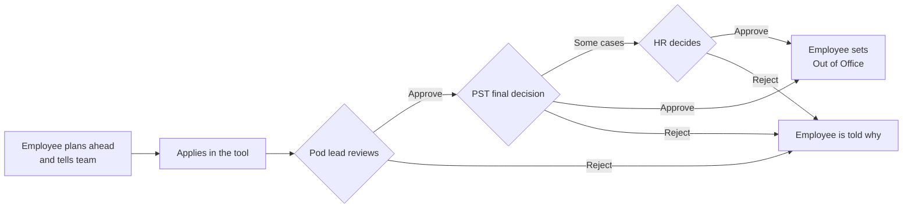
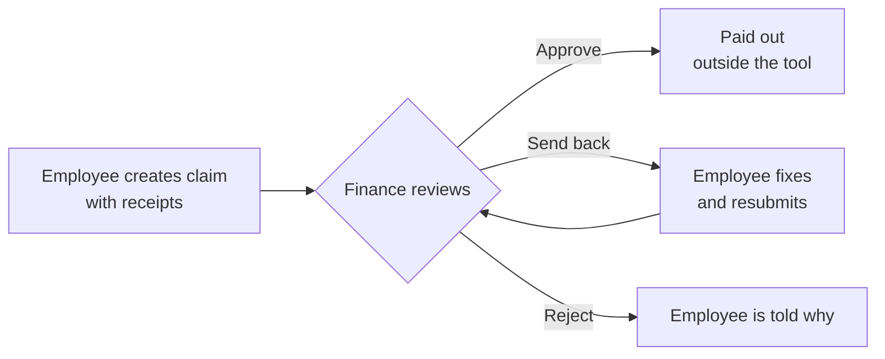
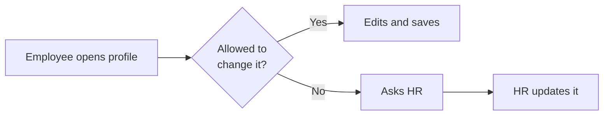

# As-Is Assessment

How things work today, before the new platform. Part 1 covers every module; Part 2 maps the three Release 1 tasks step by step. Gaps are filled in the interviews (see the [discovery plan](02-discovery-plan.md)).

## Part 1: Modules today

| Module | Today | What we need to learn |
|---|---|---|
| **Employee Profile** | In the tool (see Map 3) | What employees can change themselves, and what goes through HR |
| **Leaves** | In the tool. The pod lead approves, then PST gives the final decision; some cases go to HR *(to confirm)*. Unlimited leave after confirmation (see Map 1). | What a "balance" means under unlimited leave, which leave types are still used, and where black-out dates and quorum are tracked today |
| **Expenses** | In the tool. Finance approves *(to confirm)*. Ten categories; vehicle expenses go under Others (see Map 2). | Limits per category, and how approved claims reach payout |
| **Feedback** | In the tool | How feedback works today |
| **360 reviews** | Unknown | Whether they happen, and where |
| **PIP** | Unknown | Whether PIPs are run in the tool or outside it |
| **Assignments** | In the tool, purpose unclear | **What it's used for, and by whom** |
| **Teams & Pods** | Each person's pod is recorded in the tool | The right name, and whether pod lead and manager are the same person |
| **Onboarding & Offboarding** | Unknown | Which steps happen in the tool and which in email or spreadsheets |
| **Policies & Announcements** | Missing | Where people find them today |
| **Letters** | Missing | Which letters people ask for most |
| **Reports** | Leave Balance, Leave Balance Summary, Vehicle Expenses | Who uses each one, and whether any others are needed |

## Part 2: As-is process maps

Feedback, reviews and onboarding are mapped after the interviews.

### Pain across all three

- Slow, hard to use, and not intuitive.
- People can see beyond their role. Personal and sensitive information and files are visible to other employees in some places.
- Poor UI and UX, reflected in low survey satisfaction.

### Map 1: Apply for and approve leave

| Rules today | |
|---|---|
| Who approves | The pod lead, then PST for the final decision *(to confirm)*. HR also decides leave during probation (including long or emergency leave), maternity leave, paternity leave, and possibly leave of absence. |
| Entitlement | Unlimited leave once confirmed |
| Limits | Probation: 1 leave a month, 2 days at a stretch. Notice: leave may extend it. |
| Checked by hand | Team quorum (50% of each role) and black-out dates |

**Specific pain:** quorum, black-out dates and probation limits are all checked outside the tool.

### Map 2: Submit and approve an expense

| Rules today | |
|---|---|
| Who approves | Finance *(to confirm)* |
| Categories | Conferences, Home office setup, Learning and development, Micromeet, OKR meet, Software tooling, Term insurance, Trainings (in person), Work in person (WIP), Others |
| Vehicle expenses | Claimed under Others, with their own report |
| Payout | Outside the tool |

**Specific pain:** other people's claims and receipts can be seen.

### Map 3: Update my profile

| Rules today | |
|---|---|
| Employee changes | Personal and contact details |
| HR changes | Role, department, location, manager, joining date |

**Specific pain:** colleagues can see more than they should.

[ ] Reviewed
