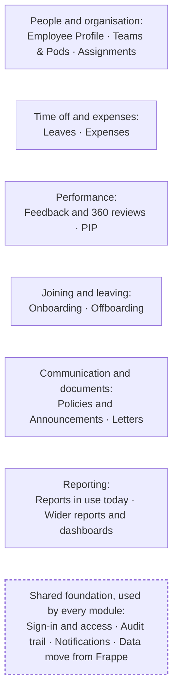
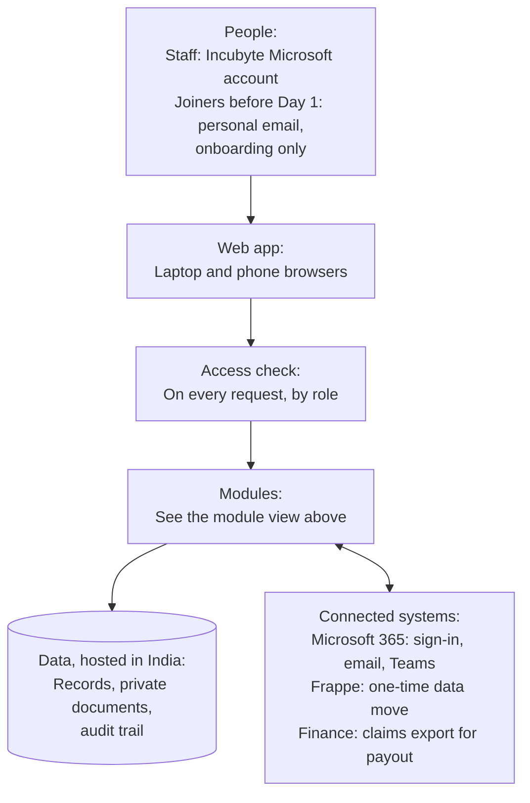

# Product Requirements Document (PRD)

## Summary

This document describes what the People Platform does and who it serves. The problem, goals, scope and release plan are set out in [Vision and Scope](../stage-1-problem-and-vision/01-vision-and-scope.md), and the detailed, testable behaviour of each module is in the [Functional Specification](../later-stages/stage-4-requirements/functional-specification.md).

| | |
|---|---|
| **Users** | Fewer than 300 employees, all in India and all on Microsoft 365 |

## Platform at a glance

### Modules

Modules grouped by the area of work they cover. The release for each module is shown in the sections below.



How the modules depend on each other:
- Every module uses the **Employee Profile**, which holds each person's manager and pod lead.
- **Teams & Pods** adds black-out dates and the "who's away" check to **Leaves**.
- **Onboarding** starts from the joiner's profile, and **Offboarding** ends their sign-in.
- **Reports** draw on **Leaves** and **Expenses**.

### High-level architecture

How the platform fits with the people who use it and the systems around it. Technology choices are made in Stage 6.



## Who uses it

Each role sees only what it needs to do its job. One person can hold several roles; for example, a manager is also an employee.

| Role | What they do | What they see |
|---|---|---|
| **Employee** | Maintains their profile, applies for leave, claims expenses, and gives and receives feedback | Their own record and a basic colleague directory |
| **Pod Lead** | Approves their members' leave as the first step | Their members' work profiles and leave requests, but never feedback, reviews or PIPs |
| **People Success Team (PST)** | Makes the final decision on leave and runs offboarding | Leave requests and history, and exit checklists |
| **HR** | Owns employee records, leave rules, special leave cases, review cycles, PIPs, policies and letters | Everyone, with sensitive details revealed only through a recorded action |
| **Manager** | Reviews their team and runs PIPs with HR | Their reporting line, but never sensitive details |
| **Finance** | Approves expense claims and sends them for payout | All expense claims, and no other personal information |
| **Talent Acquisition (TA)** | Runs onboarding from offer acceptance until the joiner has settled in | Everything needed to run onboarding (see below) |
| **Buddy** | Supports the joiner once they have started, through a few tasks set by TA | Only the tasks assigned to them |
| **Admin** | Manages roles and settings | Settings only, and no personal data unless they also hold the HR role |

### Talent Acquisition access during onboarding

**Summary:** TA sees everything needed to run onboarding, and the status of sensitive documents rather than their contents.

TA needs a complete view of onboarding, but not of the joiner's sensitive documents. The rule is simple: **TA sees the status of a sensitive document, not its contents.**

| TA can see | TA cannot see |
|---|---|
| Name, role, team, joining date and work location | The contents of ID documents such as PAN, Aadhaar or passport |
| Personal email and phone, until the work account is active | Bank details |
| Offer status and the confirmed joining date | Salary details after the offer stage |
| Every onboarding task, its owner and its due date | Medical or health declarations and insurance nominees |
| Whether each document is submitted, verified or missing | The full background check report (TA sees only whether it is clear or flagged) |
| Laptop, ID card and access requests | Emergency contacts |
| The buddy assignment and the bi-weekly 1:1 schedule | Anything after onboarding, such as feedback, reviews, leave or expenses |

TA's access to a joiner ends when their onboarding checklist is closed. If TA ever needs to open a sensitive document, HR provides it, and the access is recorded.

## Who sees sensitive information

| Information | Who can see it | Who never sees it |
|---|---|---|
| **Personal and sensitive details** (salary, ID numbers, bank details) | The employee and HR, masked until revealed through a recorded action | Managers, pod leads, TA, Finance and Admin |
| **Leave requests and reasons** | The employee, their own pod lead, PST and HR | Other employees, other pod leads, and managers who are not approvers. The "who's away" view shows only that someone is away. |
| **Expense claims and receipts** | The claimant and Finance | Everyone else |
| **Feedback** | The giver, the recipient and HR. The recipient's manager sees an item only if the recipient shares it. | Pod leads, skip-level managers, Admin, Finance and colleagues |
| **Review content** | The employee, each reviewer (their own review only), the direct manager and HR | Pod leads, skip-level managers, Admin, Finance and colleagues |
| **PIPs** | The employee, their current direct manager and HR | Everyone else. A PIP never appears anywhere else in the platform. |

Anyone who tries to open something outside their role sees "not found", and the attempt is recorded.

## Release 1: Core

### Employee Profile

**Summary:** One trusted record for each person. Employees keep their own details current, and HR maintains the rest.

```flow
HR creates the record → Employee completes their details → Changes kept as dated history
```

**What it does**
- Employees keep their personal details, contact details and emergency contacts up to date.
- HR creates and maintains each record, including the employee's manager and pod lead. Every employee has a pod lead, who approves their leave. Changes to job details are kept as dated history.
- Colleagues can find each other in a directory and an org chart.
- Sensitive details are masked, and every reveal is recorded.
- Employee documents, such as ID proofs and certificates, are stored privately.

### Leaves

**Summary:** Employees apply in a few steps. The pod lead approves, PST makes the final decision, and HR handles special cases. Confirmed employees have unlimited leave.

```flow
Employee applies → Pod lead approves → PST makes the final decision → Employee sets Out of Office
Special cases: Probation, maternity, paternity and possibly leave of absence → HR also decides
```

**What it does**
- Employees apply for full or half days and see how many working days a request uses.
- Confirmed employees have unlimited leave. Everyone can see the leave they have taken and their history.
- **The pod lead approves first, and PST makes the final decision** *(to confirm)*. HR also decides the special cases shown above.
- Employees can see which step their request is waiting on, and can cancel a request.
- Employees on probation or serving notice are reminded of the rules that apply to them. Reminders never block a request.
- HR sets up leave types, holidays and the rules for probation, notice and special cases. Employees choose their optional and floating holidays.
- A "who's away" view shows colleagues' leave without the type or reason.
- Once leave is approved, the employee is reminded to set Out of Office in Outlook and Teams.

**In Release 1, PST checks team availability and black-out dates manually.** Teams & Pods automates both checks in Release 3.

### Expenses

**Summary:** Employees claim expenses with receipts and track their progress. Finance approves claims and sends them for payout.

```flow
Draft → Submitted → Finance review → Approved → Exported for payout
Returned: Finance returns the claim → Employee corrects and resubmits
Rejected: Finance rejects with a reason → Employee is notified
```

**What it does**
- Employees claim expenses with receipts, save drafts, and track each claim's status.
- Claims use the ten categories in use today. Vehicle expenses are claimed under Others and marked as vehicle expenses.
- Finance approves a claim, rejects it with a reason, or returns it for changes. Nobody can decide their own claim.
- Possible duplicates and items over their category limit are flagged for Finance.
- Finance exports approved claims for payout outside the platform, and each claim is exported only once.

### Reports in use today

**Summary:** The three reports people rely on today: Leave Balance, Leave Balance Summary and Vehicle Expenses.

```flow
Leave records → Leave Balance and Leave Balance Summary (HR, PST)
Vehicle claims under Others → Vehicle Expenses (Finance)
```

**What it does**
- **Leave Balance** and **Leave Balance Summary** show leave taken by type, for each employee and across the company. They are available to HR and PST.
- **Vehicle Expenses** lists vehicle claims for a chosen period. It is available to Finance.

### Sign-in and access

**Summary:** One Microsoft sign-in, and each person sees only what their role requires.

```flow
Microsoft sign-in → Role checked on every request → Only permitted screens and data
```

**What it does**
- People sign in with their Incubyte Microsoft account, with no separate passwords. The only exception is joiners before Day 1 (see Onboarding).
- Access is checked on every request, and menus show only what each person can use.
- Sessions time out after a period of inactivity, and leavers lose access immediately.

### Audit trail

**Summary:** A permanent record of who did what, and who viewed sensitive information.

```flow
Change, sign-in or sensitive view → Permanent entry → HR searches
```

**What it does**
- Records every change, sign-in and denied access, and every view of sensitive data, feedback, reviews or PIPs.
- Entries cannot be edited or deleted. HR can search the record.

### Notifications

**Summary:** Email and in-portal alerts whenever someone needs to act.

```flow
Action needed → Portal notification + email (summary and link only) → Person opens the item
```

**What it does**
- People are alerted in the portal and by email when they need to act.
- Emails carry only a short summary and a link, never personal or performance details.
- If an email fails, the portal alert still appears and the email is retried.

### Data move from Frappe

**Summary:** Bring today's data across, verify it, and switch Frappe off.

```flow
Frappe → Move → Check report → HR and Finance sign off → Frappe switched off
```

**What it does**
- Moves people records, all leave records and history, and past expense claims with their receipts. Holidays are set up fresh.
- A check report shows what moved and what didn't. HR signs off the people and leave data, and Finance signs off the expense data.
- The move can be run again safely, without creating duplicates.
- Pods move in Release 3. HR decides whether feedback, reviews and PIPs are moved or archived.

## Release 2: Performance and lifecycle

### Feedback and 360 reviews

**Summary:** Feedback at any time, plus 360 review cycles run by HR, all private to the people involved.

```flow
Anytime: Colleague gives feedback → Recipient reads → Optionally shares with manager
Review cycle: HR launches → Nominations → Self and peer reviews → Manager finalises → Employee acknowledges
```

**What it does**
- Anyone can give a colleague feedback at any time, with their name shown *(to confirm)*. Recipients can share an item with their manager, or report it to HR.
- HR runs review cycles and sets who is included, the questions and the deadlines.
- Each person writes a self-review and nominates peers. Their manager writes and finalises the review, and the employee acknowledges it (seen, not agreed).
- Reminders go out before each deadline, and HR tracks completion.

### PIP

**Summary:** A fair, structured and strictly confidential plan to help someone improve.

```flow
Manager or HR drafts → HR approves → Employee acknowledges → Check-ins → HR records the outcome
```

**What it does**
- HR or the direct manager drafts a plan with goals, success criteria, dates and check-ins. The employee sees it only after HR approves it *(to confirm)*, and acknowledges it.
- The manager records progress at each check-in, and the employee can comment.
- HR records the outcome: Successful, Extended or Unsuccessful.
- A PIP never appears on profiles, in the directory, on calendars, in search or in reports.

### Onboarding

**Summary:** TA runs a shared checklist so every joiner has a smooth start.

```flow
Offer accepted → TA starts the checklist → Joiner uploads documents → Day 1 → TA assigns buddy and bi-weekly 1:1 → Checklist closed, TA access ends
```

**What it does**
- TA owns onboarding and sets up checklist templates, with tasks for TA, HR, the manager and the joiner. Task owners are reminded when a task is overdue.
- Before Day 1, joiners sign in with their personal email and see only the onboarding module *(to confirm)*. From Day 1 they use their Incubyte Microsoft account.
- Joiners upload the documents requested of them. TA sees each document's status, not its contents (see TA access above).
- Once the joiner has started, TA assigns a buddy, schedules a bi-weekly 1:1 between them, and gives the buddy a few tasks.
- Assets handed over, such as a laptop, are recorded.

### Offboarding

**Summary:** A clean, complete exit, with access removed immediately.

```flow
HR starts the exit → PST checklist: assets, handover, access → Last working day → Sign-in removed, record kept for HR
```

**What it does**
- HR starts an exit and sets the last working day. PST owns the exit checklist: asset return, handover and access removal.
- If the leaver manages people, HR is prompted to reassign their direct reports.
- After the last working day, the leaver can no longer sign in. Their record is kept, and only HR can see it.

### Letters

**Summary:** Employees get standard HR letters on demand, without waiting on HR.

```flow
Employee requests a letter → HR approves (some letters) → Employee downloads it
```

**What it does**
- HR maintains letter templates, such as employment verification and address proof.
- Employees request and download letters. Some letters need HR approval first.
- Every letter has a reference number and is recorded.

## Release 3: Organisation and communication

### Policies and Announcements

**Summary:** One official home for policies and company news, delivered everywhere at once.

```flow
Publisher posts → Portal + Email + Teams channel, under the publisher's name → Broadcast record kept
```

**What it does**
- HR publishes policies with a version history, and employees acknowledge key policies.
- HR and named publishers post announcements to everyone, or to chosen departments or pods.
- Every policy and announcement goes out at once to the portal, by email and to the company-wide Microsoft Teams channel, under the publisher's own name.
- Each item keeps a record of when it was sent, by whom and where. Failed deliveries can be resent.

### Teams & Pods *(working name)*

**Summary:** Each person's pod, its lead and members, along with the leave checks that depend on team membership.

```flow
Employee applies for leave → Sees pod black-out dates and who's away → PST warned if a role drops below half
```

**What it does**
- HR creates pods, assigns a lead and adds members, and moves between pods are kept as history. Pods move over from Frappe.
- Employees see their pod and who in it is away, without the leave type or reason.
- Each pod sets its black-out dates and each member's pod role (Dev, QA or BQA). Employees see these when applying for leave.
- PST is warned when approving leave would leave too few people in a pod role.

### Assignments

**Summary:** Retained from today's tool. Its purpose will be confirmed in the Stage 2 interviews before it is designed.

**Initial idea, to be confirmed**
- Records who is working on which client and project, with dates and allocation.
- Does not include billing, rates or staffing search.

## Later

### Wider reports and dashboards

**Summary:** Reporting beyond today's three reports, such as headcount and review completion.

**What it does**
- Follows the same access rules as the rest of the platform. PIPs are never included.

## Quality standards

| Area | Standard |
|---|---|
| **Ease of use** | Common tasks take a few clear steps on a laptop or phone, with intuitive navigation and menus |
| **Speed** | Common screens load in under 2 seconds |
| **Security** | Access is checked on every request, sensitive data is encrypted and masked, and an independent security review takes place before launch |
| **Audit** | Every change, and every view of sensitive data, is recorded |
| **Reliability** | Data is backed up daily, and no leave or expense record is lost or duplicated |

## Main risks

| Risk | How we reduce it |
|---|---|
| Leave rules turn out to be more complex than expected | Confirm the rules with PST and HR before design begins |
| Frappe data is inconsistent | Run a trial move early, and have the checks signed off before switching over |
| Someone sees data beyond their role | Check access on every request, test it for every role, and review it before launch |
| Feedback, reviews or PIPs reach the wrong person | Hide them by default, return "not found" when access is denied, record every view, and keep their content out of notifications |
| The new platform is not clearly easier to use | Test each task with real employees before launch |

## Decisions so far

- Leave is approved by the pod lead first, and PST makes the final decision. HR also decides probation, maternity, paternity and possibly leave-of-absence cases *(to confirm)*.
- Confirmed employees have unlimited leave.
- Every employee's pod lead is recorded in Release 1, so leads can approve leave before Teams & Pods arrives.
- PST checks team availability and black-out dates manually until Release 3.
- TA owns onboarding, assigns the buddy once the joiner has started, and sees document status rather than document contents.
- Vehicle expenses are claimed under Others.
- Policies & Announcements remains in Release 3.
- Announcements post to Teams under the publisher's own name.

## Open questions

1. Is the approval order correct (pod lead, then PST, with HR for special cases), and is leave of absence one of the HR cases?
2. With unlimited leave, what should a "balance" track, and which leave types are still in use?
3. Is Finance the only approver for expenses, and what limits apply to each category?
4. What is Assignments used for?
5. Is the pod lead the same person as the manager, is the "team" used for availability checks the same as a pod, and what should Teams & Pods be called?
6. Should feedback be named or anonymous?
7. Can a PIP start without HR approval?
8. Should past feedback, reviews and PIPs be moved or archived?
9. Which work does PST own and which does HR? In particular, who runs offboarding?
10. Can joiners' personal-email access before Day 1 be limited to the onboarding module?
[ ] Reviewed
